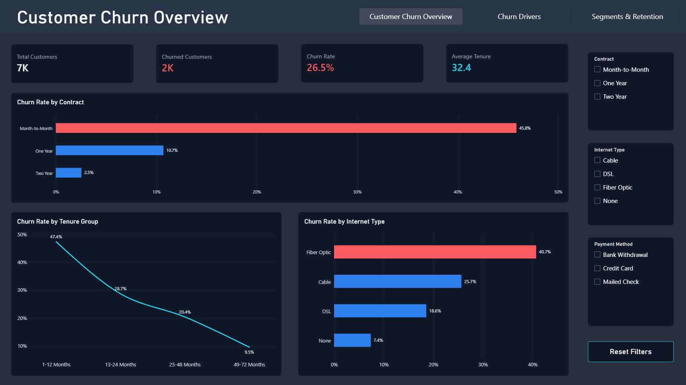
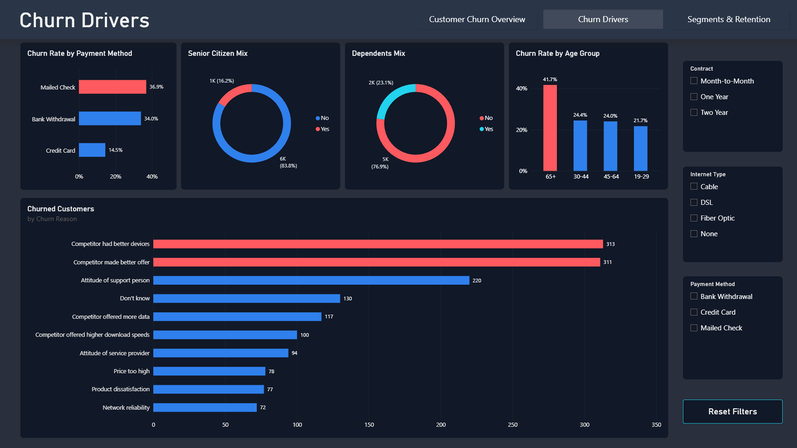
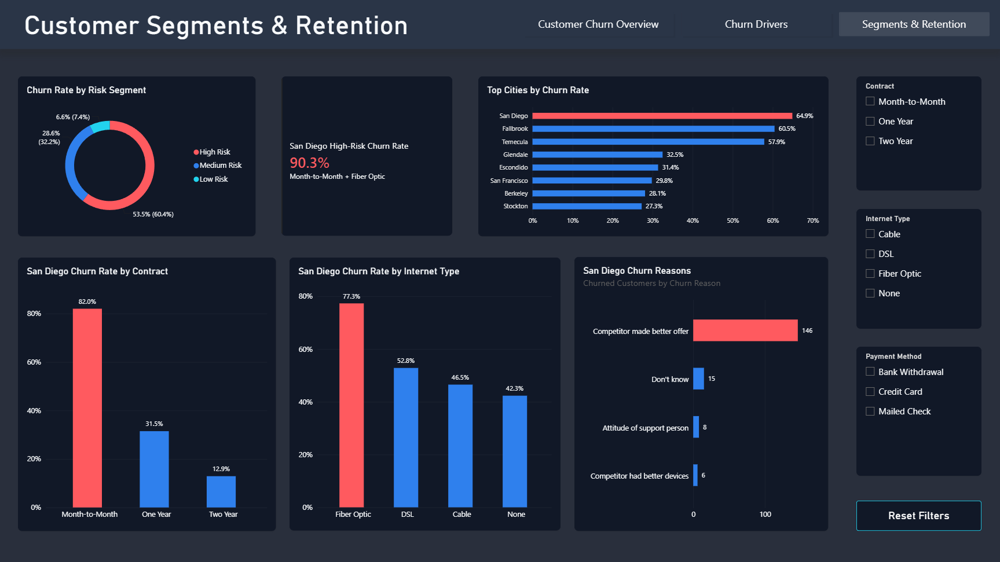

📊 Customer Churn & Retention Analysis

 SQL Server + Power BI project focused on identifying churn patterns, high-risk customer segments, and retention opportunities.

🎯 Objective

 Analyze customer behavior, services, demographics, and geography to understand which customer groups are most associated with churn.

🛠️ Tools

 SQL Server

 Power BI

 DAX

🔎 Key Insights

 📉 Overall churn: 26.5%

 📄 Month-to-Month churn: 45.8%

 🆕 1–12 month tenure churn: 47.4%

 🌐 Fiber Optic churn: 40.7%

 👴 Senior Citizen churn: 41.7%

 ⚔️ Competitor-related reasons dominated churn
 
 📍 San Diego churn: 64.9%
    

🚨 Highest-Risk Segment

 San Diego + Month-to-Month + Fiber Optic

 Churn rate: 90.3%

 82.1% reported: Competitor made better offer

🎯 Risk Segmentation

 🔴 High Risk: 53.5%

 🔵 Medium Risk: 28.6%

 🟢 Low Risk: 6.6%
    

📊 Dashboard

### 🧭 Customer Churn Overview

  

### 🔍 Churn Drivers

  

### 🎯 Segments & Retention Opportunities

  

💡 Recommendations

   ➡️ Focus on Month-to-Month customers

   ➡️ Target customers in their first 12 months

   ➡️ Investigate Fiber Optic churn

   ➡️ Review competitor offers in San Diego

   ➡️ Improve support experience

📁 Files

01_Data_Profiling_Validation.sql

02_Exploratory_Data_Analysis.sql

03_Advanced_Analysis.sql

Customer_Churn_Dashboard.pbix
